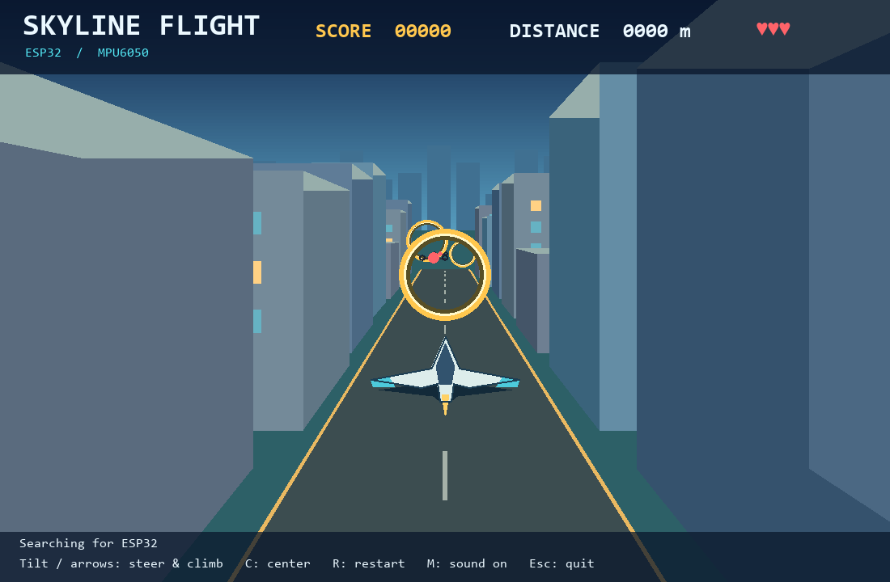
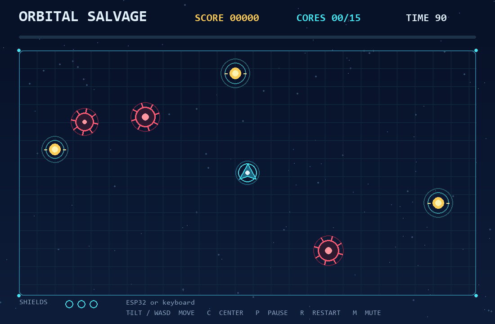
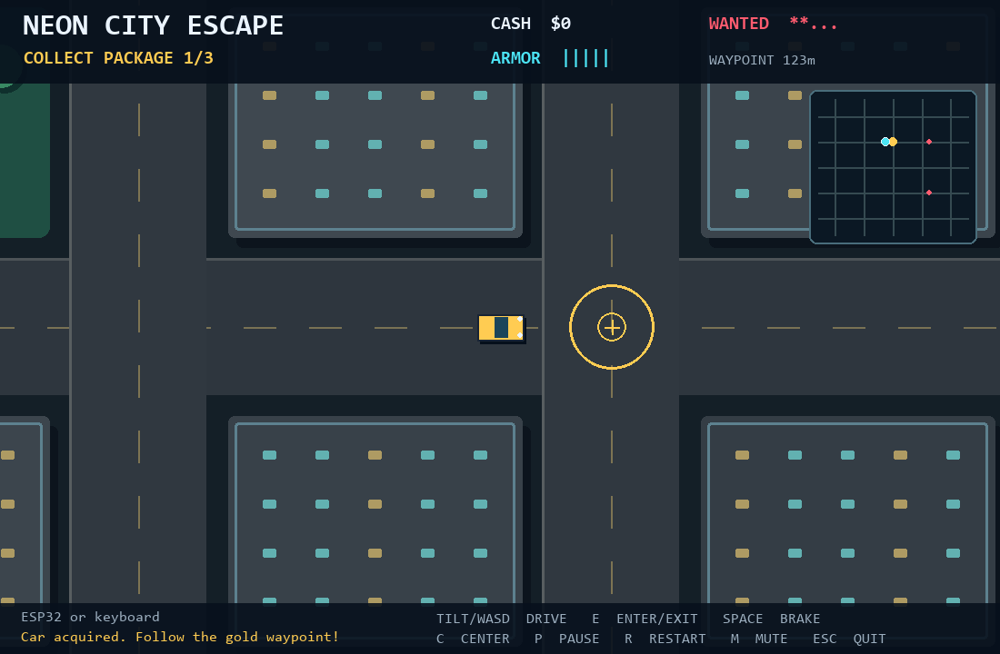
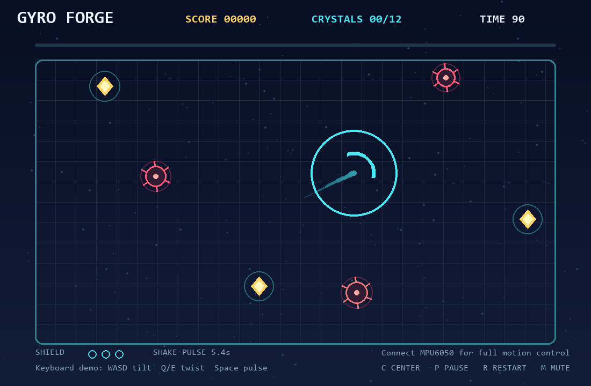

# ESP32 + MPU6050 tilt games

Four desktop games use the same ESP32 + MPU6050 controller. **Skyline Flight** is an aircraft run through a city. **Orbital Salvage** is a top-down arena collection game. **Neon City Escape** is a driving mission with a police chase. **Gyro Forge** is built around the motion sensor itself: tilt changes a ball's gravity, twisting turns a shield, and shaking sends out a defensive pulse. All four games also have keyboard controls.

| Skyline Flight | Orbital Salvage |
| --- | --- |
|  |  |





## Hardware and wiring

Use an ESP32 DevKit, an MPU6050 breakout, four jumper wires, and a **data-capable USB cable** to the computer running the game.

| MPU6050 | ESP32 DevKit |
| --- | --- |
| VCC | 3V3 |
| GND | GND |
| SDA | GPIO 21 |
| SCL | GPIO 22 |

Use **3.3 V** so the I2C lines stay safe for the ESP32. For another ESP32 variant, change `SDA_PIN` and `SCL_PIN` near the top of the sketch to available I2C pins. The sensor's `AD0` pin can remain unconnected (default address `0x68`).

## Upload the ESP32 sketch

1. Install Arduino IDE and the **esp32 by Espressif Systems** board package.
2. In Library Manager install **Adafruit MPU6050** and **Adafruit Unified Sensor**. Install **Adafruit BusIO** if prompted.
3. Open `esp32-Aircraft-City-MPU6050.ino`, select your board and USB port, and upload.
4. Keep the controller level and still for the first second after reset. You may verify `READY,MPU6050`, `IMU,roll,pitch`, and `MOTION,roll,pitch,yaw,shock` lines in Serial Monitor at **115200 baud**. **Close Serial Monitor before starting a game**, because only one program can own the port. Re-upload this updated sketch to use Gyro Forge's twist and shake controls.

## Run the games

From this folder in a terminal:

```powershell
py -m venv .venv
.\.venv\Scripts\Activate.ps1
python -m pip install -r requirements.txt
python game.py
```

Run `python salvage.py` for Orbital Salvage, `python city_escape.py` for Neon City Escape, or `python gyro_forge.py` for Gyro Forge. All four games use the same sketch and dependencies. Run one game at a time because the USB serial port can only be opened by one program.

If auto-detection does not find your ESP32, specify its port (look in Arduino IDE or Windows Device Manager):

```powershell
python game.py --port COM5
```

Use `python salvage.py --port COM5`, `python city_escape.py --port COM5`, or `python gyro_forge.py --port COM5` for the other games. All four accept `--invert-roll` and `--invert-pitch` if the controller is mounted in the opposite direction.

On Linux or macOS, use `python3 -m venv .venv`, activate with `source .venv/bin/activate`, and pass a port such as `/dev/ttyUSB0` or `/dev/cu.usbserial-...` if needed. Python 3.10 or newer is recommended.

## Play Skyline Flight

| Action | Sensor / key |
| --- | --- |
| Steer | Tilt left/right, or `A`/`D` / arrow keys |
| Climb / dive | Tilt forward/back, or `W`/`S` / arrow keys |
| Set neutral position | Hold controller comfortably and press `C` |
| Restart | `R` or `Enter` after a crash |
| Mute / unmute | `M` |
| Quit | `Esc` |

The aircraft moves automatically forward. A ring gives 100 points, with a combo bonus for consecutive rings. Three collisions end a run. The game plays an engine hum, a ring pickup sound, collision alerts, and a game-over sound. The sounds are generated by the game, so no audio files are needed. Keyboard input works even when a sensor is connected and takes priority while held. If the directions feel reversed because of how the sensor is mounted, launch with `--invert-roll` and/or `--invert-pitch`.

## Play Orbital Salvage

Tilt the controller left/right and forward/back to move the drone around the arena. Collect 15 gold energy cores within 90 seconds. Red mines bounce around the arena; three hits end the mission. A quick collection streak increases the score multiplier, and a new mine appears after every five cores.

| Action | Sensor / key |
| --- | --- |
| Move | Tilt, or `W`/`A`/`S`/`D` / arrow keys |
| Set neutral position | Hold the controller comfortably and press `C` |
| Pause / resume | `P` |
| Restart | `R`, or `Enter` after a mission ends |
| Mute / unmute | `M` |
| Quit | `Esc` |

Keyboard input overrides the sensor on each axis while a key is held. Orbital Salvage creates its graphics and sound effects in code; no extra assets are needed to play.

## Play Neon City Escape

Walk to the gold car and press `E` to enter. Tilt forward to accelerate and left/right to steer. Follow the gold waypoint and minimap to collect three packages, then drive to the green garage. Police cars follow the roads and can damage your vehicle; five hits end the mission. You can leave a car and enter another one.

| Action | Sensor / key |
| --- | --- |
| Walk / steer | Tilt left/right and forward/back, or `W`/`A`/`S`/`D` / arrow keys |
| Enter / leave a nearby car | `E` |
| Brake / handbrake | Tilt back or press `S`; hold `Space` for a tighter turn |
| Set neutral position | Hold the controller comfortably and press `C` |
| Pause / resume | `P` |
| Restart | `R`, or `Enter` after a mission ends |
| Mute / unmute | `M` |
| Quit | `Esc` |

On foot, tilt moves in two dimensions. In a car, forward/back controls acceleration and braking while left/right steers. The `E` and `Space` actions use the keyboard because the existing MPU6050 controller has no buttons. Neon City Escape draws the city, cars, and minimap in Pygame; the preview image is not required to play.

## Play Gyro Forge

Collect 12 gold crystals in 90 seconds. Tilting the MPU6050 accelerates the ball like gravity on a board; level the controller and the ball keeps some momentum. Twist the controller in its own plane to aim the cyan shield arc at approaching red hazards. A quick shake sends out a pulse that knocks hazards away. The pulse takes 5.5 seconds to recharge. Three unshielded hits end the round. Shake after a win or loss to play again.

| Action | MPU6050 / keyboard |
| --- | --- |
| Roll the ball | Tilt left/right and forward/back / `W` `A` `S` `D` or arrows |
| Turn the shield | Twist the board in its own plane / `Q` and `E` |
| Defensive pulse | Shake the board / `Space` |
| Recenter tilt and gyro bias | Hold the board level and still, then press `C` |
| Pause / resume | `P` |
| Restart | Shake after game over, `R`, or `Enter` after game over |
| Mute / unmute | `M` |
| Quit | `Esc` |

If twist feels reversed, add `--invert-yaw`. If shakes are too hard or too easy to trigger, adjust `--shake-threshold`, for example `python gyro_forge.py --shake-threshold 3.0`. The bottom of the screen shows live roll, pitch, twist rate, and shake strength to help tune it. Keyboard controls remain available when the sensor is disconnected.

The games read USB serial at 115200 baud. The sketch sends `IMU,<roll degrees>,<pitch degrees>` and `MOTION,<roll degrees>,<pitch degrees>,<yaw degrees/second>,<shake m/s²>` about 50 times per second. The `IMU` packet keeps the first three games compatible; Gyro Forge reads the extra motion values. Sending `C` resets tilt center and gyro bias. The sketch's left/right roll direction is reversed with `ROLL_DIRECTION = -1.0`. The games reconnect automatically if the board is unplugged and reconnected.

## Troubleshooting

| Problem | Try |
| --- | --- |
| Game says no ESP32 connected | Check the USB data cable and port; close Arduino Serial Monitor; pass `--port COMx`. |
| Sketch reports MPU6050 not found | Recheck 3V3, GND, SDA 21, SCL 22; ensure the board and module share ground. |
| Aircraft drifts | Hold the controller neutral and press `C`. |
| Controls are backward | Use `--invert-roll` or `--invert-pitch`. |
| Gyro Forge has tilt but no twist or shake | Re-upload the updated sketch and check for `MOTION,...` lines in Serial Monitor, then close the monitor. |
| Shake pulse triggers too often or not at all | Watch the shake value at the bottom of Gyro Forge and adjust `--shake-threshold`. |
| Python says `No module named pygame` | Activate the virtual environment and run `python -m pip install -r requirements.txt`. |

No Wi-Fi setup is needed. All four games draw their graphics with Pygame.
